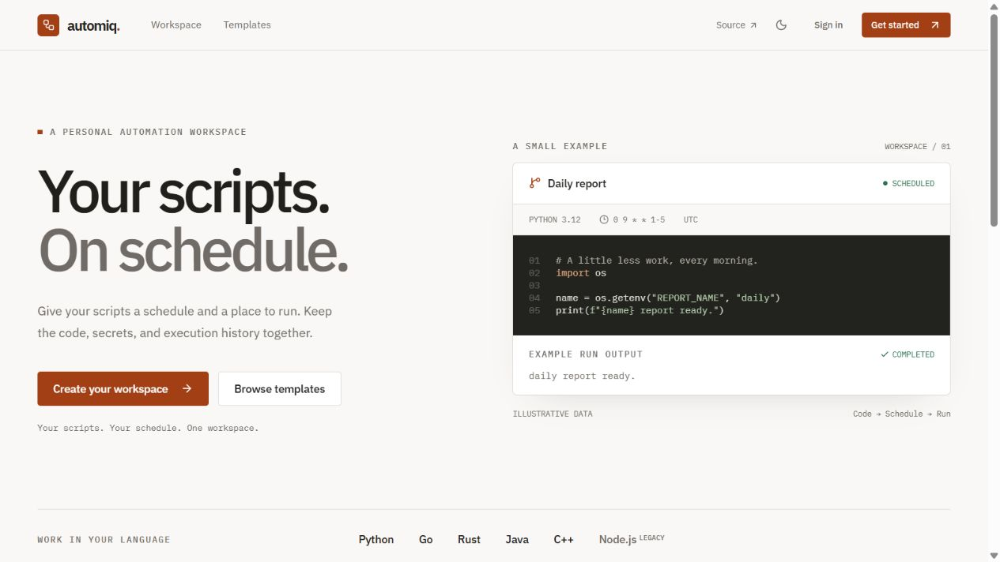
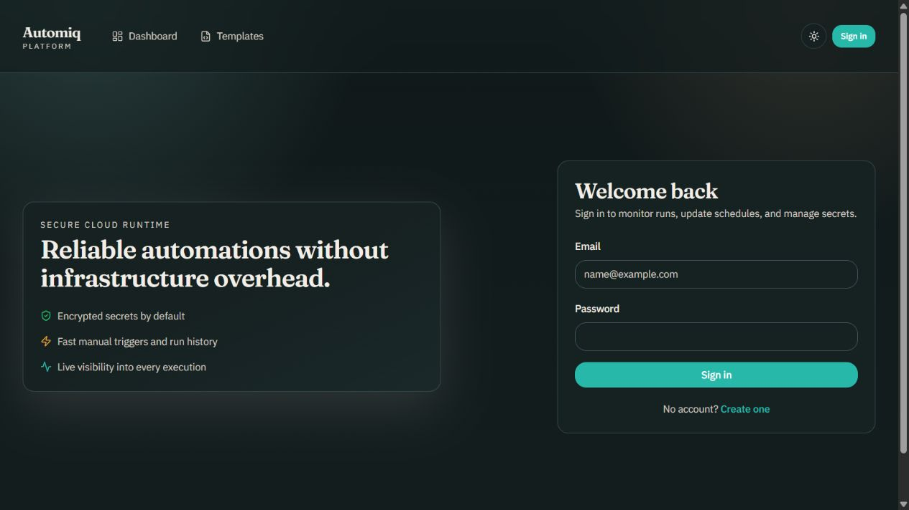
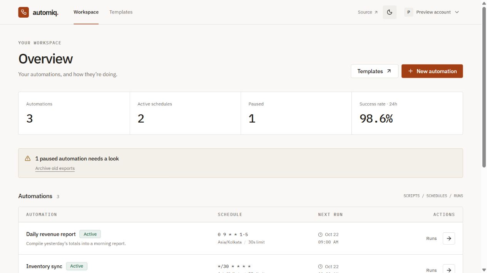

# Automiq

Personal automation workspace: cron-style jobs plus a multi-runtime code runner. Not a production SaaS product.

## Demo

- [Live frontend](https://automiqs.vercel.app/) (the older repository homepage redirects here).
- [Live API base via the frontend proxy](https://automiqs.vercel.app/api/v1).
- [API session check](https://automiqs.vercel.app/api/v1/session).
- Login: the deployed sign-in page does not publish shared demo credentials. Use
  [Create account](https://automiqs.vercel.app/signup) with a separate demo-only account,
  or run locally and sign up with your own test credentials. No shared login is provisioned by this repo.
- The Render API may sleep when idle. The first request can be slow while it wakes;
  wait about a minute and retry if the initial sign-in or data request times out.
- Suggested walkthrough: create an automation, select a runtime, set a cron schedule,
  trigger a manual run, and inspect the output in run history. Run only trusted code.

Screenshots below show the redesigned local production build. The dashboard uses
synthetic preview data from a temporary local API fixture, not a production account.
The fixture server is not part of the app. Deployment updates after merge.

| Landing page | Sign in | Workspace (preview data) |
| --- | --- | --- |
|  |  |  |

## Stack

- Frontend: Next.js App Router + TypeScript + Tailwind (`apps/web`)
- Backend: Fastify + Better Auth + Drizzle (`apps/api`)
- Database: PostgreSQL (Railway)
- Scheduler: durable PostgreSQL tasks with a polling worker; optional protected cron wake-up

## Monorepo Layout

- `apps/api` Fastify API, auth, scheduler, executor, DB
- `apps/web` Next.js dashboard and template marketplace
- `packages/shared` Shared Zod schemas and API types

## Core Capabilities

- Email/password signup and login via Better Auth sessions
- Automation CRUD with cron schedule and timezone
- Encrypted per-automation secrets (AES-256-GCM)
- Approved Docker execution with filesystem/network boundaries and CPU, memory, process, timeout and output limits (production execution is disabled until configured)
- Multi-runtime execution support for Node.js, C++, Java, Python, Go, and Rust
- Run history/logs and manual trigger
- Internal scheduler endpoint (`/api/v1/internal/run-due-automations`)
- Public template publishing and clone workflow

## Local Development

1. Install pnpm
   - `corepack enable`
   - `corepack prepare pnpm@10.6.5 --activate`
2. Install dependencies
   - `pnpm install`
3. Configure env files
   - `apps/api/.env` from `apps/api/.env.example`
   - `apps/web/.env.local` from `apps/web/.env.example`
   - Generate `MASTER_ENCRYPTION_KEY` with:
     - `node -e "console.log(require('crypto').randomBytes(32).toString('base64'))"`
4. Run migrations
   - `pnpm -C apps/api db:generate`
   - `pnpm -C apps/api db:migrate`
   - In development, migrations auto-run at startup by default.
   - Startup migrations run under an advisory lock by default; `AUTO_MIGRATE=false` requires an explicit migration before rollout.
5. Start apps
   - API: `pnpm -C apps/api dev`
   - Web: `pnpm -C apps/web dev`

## API Overview

See the [complete endpoint reference](docs/api/endpoints.md), including public,
session, admin and internal-token routes, plus the Better Auth passthrough.
The browser uses the same-origin `/api/v1` proxy so session and CSRF cookies stay
on the frontend origin. Internal scheduler/health endpoints must use the API host directly.

## API Integration Examples

```ts
// browser-side authenticated call
const csrf = await fetch(`${API_BASE}/api/v1/csrf-token`, { credentials: "include" }).then((r) => r.json());

const automation = await fetch(`${API_BASE}/api/v1/automations`, {
  method: "POST",
  credentials: "include",
  headers: {
    "Content-Type": "application/json",
    "x-csrf-token": csrf.csrfToken
  },
  body: JSON.stringify({
    name: "heartbeat",
    code: "print('alive')",
    runtime: "python312",
    cronExpr: "*/5 * * * *",
    timezone: "UTC",
    timeoutSeconds: 30,
    enabled: true,
    tags: ["monitoring"]
  })
}).then((r) => r.json());
```

## Security model

- Production execution defaults to **disabled** until an isolated Docker host is configured. Signup does not grant execution; an administrator approves each account. Suspension/revocation is enforced by workers too.
- Docker jobs run as non-root with no host mounts, network, capabilities or privilege escalation; root filesystems are read-only. CPU, memory, process count, writable tmpfs, execution duration and captured output are bounded. Cancellation removes the whole container.
- Only installed/probed runtime images are advertised. Dependencies must be preinstalled in reviewed images; isolated jobs cannot download packages.
- Development `trusted-subprocess` execution uses an environment allowlist, timeouts and output limits. It shares host permissions and is rejected in production. It is not a sandbox.
- Secrets use versioned AES-256-GCM encryption at rest. API reads return metadata, not plaintext. A job can read or print its own injected secrets; logs are not automatically redacted. Retain historical keys for backups and follow the [rotation procedure](docs/operations/key-rotation.md).
- Sessions use secure httpOnly cookies; application mutations require CSRF tokens. Private routes enforce ownership. Admin access and confirmation tokens are separate controls.
- Runs, retry deadlines and capacity reservations are durable in PostgreSQL. Redis is optional for caches/notifications. Recovery is at least once; use downstream idempotency for external effects. See [durable scheduling](docs/operations/durable-scheduler.md).
- This remains a personal project, not a claim of protection against all hostile tenants or container/kernel vulnerabilities. Keep the execution host patched and dedicated. See the [execution model](docs/security/sandbox.md) and [deployment verification](docs/operations/deployment-verification.md).

## Common Startup Error

- Error: `relation "user" does not exist`
  - Cause: database schema not migrated.
  - Fix: run `corepack pnpm --filter @automation/api db:migrate` (or set `AUTO_MIGRATE=true`).

## Deployment

### Railway PostgreSQL

1. Provision PostgreSQL service.
2. Copy connection URL to API `DATABASE_URL`.
3. If Railway URL uses `sslmode=require`, keep/add `uselibpqcompat=true`:
   - Example: `...?sslmode=require&uselibpqcompat=true`

### Render API

1. Create Web Service from repo root.
2. Root dir: `.`
3. Build command: `pnpm install --frozen-lockfile && pnpm --filter @automation/api build`
4. Start command: `pnpm --filter @automation/api start`
5. Health check path: `/ready`; `/health` is liveness only.
6. Set environment variables from `apps/api/.env.example`; preserve existing encryption keys.
7. Verify `/api/v1/version` matches the merged commit and `/api/v1/ready` reports schema/worker status.
8. Keep `EXECUTION_MODE=disabled` on the native Render Node service until a Docker-capable execution host is configured. See [isolated execution](docs/operations/isolated-execution.md).
9. The PostgreSQL worker polls schedules. Optional external wake-ups use `render-cron.yaml`, a supported `type: cron` service. It is not needed for correctness.

### Vercel Web

1. Create project from repo.
2. Root dir: `apps/web`
3. Build command: `pnpm build`
4. Output: default Next.js
5. Set `NEXT_PUBLIC_API_BASE_URL` to Render API domain.

## Required Environment Variables

### API

- `NODE_ENV`
- `PORT`
- `DATABASE_URL`
- `ADMIN_EMAILS` (optional bootstrap admins, comma-separated)
- `BETTER_AUTH_SECRET`
- `BETTER_AUTH_URL`
- `FRONTEND_ORIGIN`
- `CORS_ORIGINS`
- `MASTER_ENCRYPTION_KEY`
- `EXECUTION_MODE` (`disabled` by default in production; `docker` after provisioning)
- `ENCRYPTION_KEY_ID` / `ENCRYPTION_KEYRING` (optional versioned rotation keys)
- `INTERNAL_CRON_TOKEN`
- `REDIS_DUE_QUEUE` (optional, default `queue:run_due_automations`)
- `MAX_CODE_SIZE_BYTES`
- `MAX_OUTPUT_BYTES`
- `DEFAULT_TIMEOUT_SECONDS`
- `MAX_TIMEOUT_SECONDS`
- `EXECUTION_CONCURRENCY`
- `PER_USER_CONCURRENT_RUNS`
- `PER_USER_DAILY_RUN_LIMIT`
- `MAX_RUN_ATTEMPTS`
- `DUE_AUTOMATIONS_BATCH_SIZE`
- `RUN_RETENTION_DAYS`
- `OBS_ALERT_MIN_SUCCESS_RATE_24H`
- `OBS_ALERT_MAX_EXHAUSTED_RETRIES_24H`
- `OBS_ALERT_MAX_QUEUE_DEPTH`
- `OBS_ALERT_MAX_SCHEDULER_LAG_MINUTES`
- `ENABLED_RUNTIMES` (comma-separated runtime ids)
- `DEPENDENCY_ALLOWLIST_MODE` (`strict` or `relaxed`)
- `DEPENDENCY_MAX_COUNT`
- `DEPENDENCY_MAX_TOTAL_CHARS`
- `DEPENDENCY_INSTALL_TIMEOUT_SECONDS`
- `PYTHON_ALLOWED_PACKAGES` (comma-separated, used in strict mode)
- `GO_ALLOWED_MODULES` (comma-separated, used in strict mode)
- `RUST_ALLOWED_CRATES` (comma-separated, used in strict mode)

### Web

- `NEXT_PUBLIC_API_BASE_URL`
- `NEXT_PUBLIC_APP_URL`

## Testing

Run API tests:

- `pnpm -C apps/api test`

The [Tests workflow](.github/workflows/test.yml) runs API regressions, real PostgreSQL migration/concurrency/recovery tests, an encrypted backup/restore drill, six Docker runtime smoke jobs, web typechecking/build and Chromium browser regressions. Local tests skip database/container suites unless their explicit environment flags are set. Route mocks are complemented by real service integration checks; they do not establish that production infrastructure has been provisioned.

Browser checks: `pnpm -C apps/web build` then `pnpm -C apps/web exec playwright test` (install Chromium with `pnpm -C apps/web exec playwright install chromium`). See [verification details](docs/operations/deployment-verification.md).

Run full workspace tests:

- `pnpm test`

## Runtime Docs (MkDocs)

Runtime and execution-control documentation is provided via MkDocs in `docs/` with config at `mkdocs.yml`.

## Reviewable development

New work is split into focused PRs for auth, scheduler, executor, secrets/CI and
product/demo documentation. See [the review order and change history](docs/development.md).
Existing commits are preserved; the original uploads have not been rewritten.
